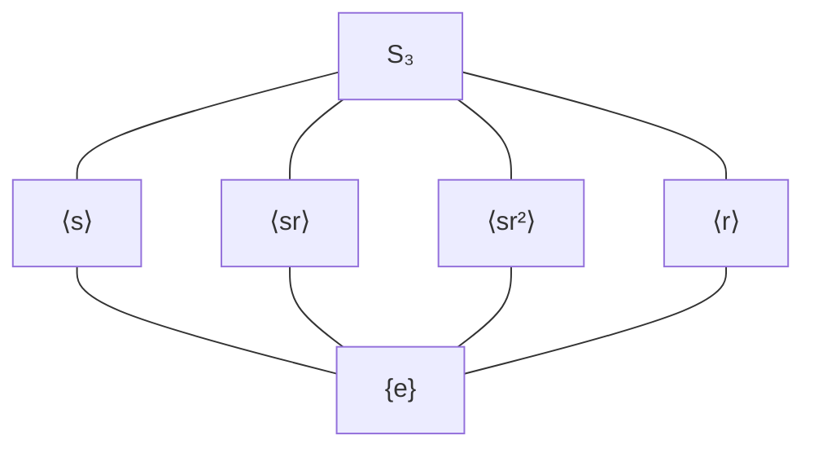
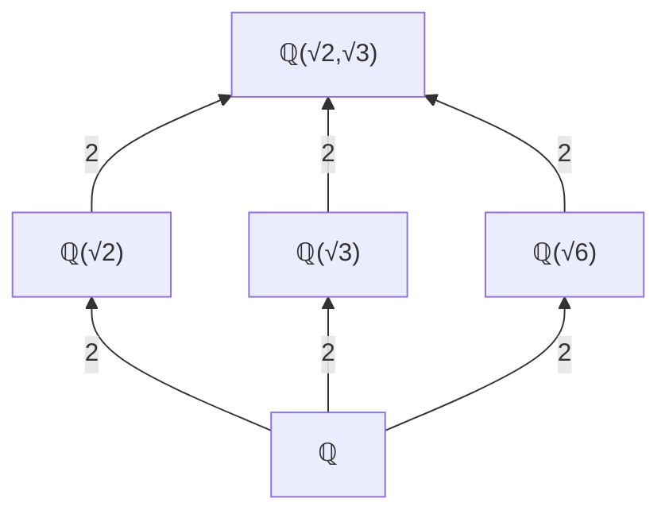

# Abstract algebra

Contents: Cayley graph · quotient group · subgroup lattice · field tower · Galois correspondence

## Cayley graph (SVG)
Node per element, one **colour per generator**, arrow g -> g·a for generator a (right multiplication; state the convention). Order-2 generators: draw an undirected edge (or a double-headed one). Compute edges from the multiplication table; do not hand-place arrows.
Layout: cyclic part on a regular n-gon: `x=cx+R cos(θ_k), y=cy-R sin(θ_k)`, θ_k=90°+360k/n. Dihedral/S3: outer ring = rotations r^k, inner ring (radius 0.55R, same angles) = s r^k.
Invariants: |nodes|=|G|; every node has exactly one outgoing arrow per generator; the a-arrows form cycles of length ord(a); graph connected iff generators generate G.
Verified generator for S3: `python3 scripts/checks.py cayley > s3.svg`.

## Quotient group G/N
Show G's Cayley graph with **cosets boxed** (translucent rounded rect per coset), then the collapsed graph with one node per box. Valid only if N is normal: check gNg⁻¹=N (equivalently left coset = right coset). If N is not normal, say the collapse is not a group.
Invariants: |G/N|=|G|/|N|; each box has |N| nodes; every arrow between two boxes has the same generator pattern (well-definedness).
Example ℤ12/⟨4⟩: N={0,4,8}; cosets {0,4,8},{1,5,9},{2,6,10},{3,7,11}; quotient ≅ ℤ4.

## Subgroup lattice (Mermaid)

Bottom = trivial, top = G, edge = maximal inclusion (Hasse diagram, no transitive edges). Label normal subgroups (e.g. bold, or ⊴). Invariants: every order divides |G|; count of subgroups matches known list; meets/joins consistent.

## Field extension tower (Mermaid)

Edge label = degree. Invariants: degrees multiply along paths ([K:ℚ]=4 every path); intermediate fields = number of subgroups of Gal. Galois correspondence: Gal(K/ℚ)≅ℤ2×ℤ2 has 3 subgroups of order 2 <-> 3 quadratic subfields; draw the subgroup lattice *upside down* next to the field lattice and link by dashed lines (subgroup H <-> fixed field K^H, inclusion reversing).

## Generators (preferred over hand-drawing)
- `cayley`/`quotient`/`hasse`: group laws are asserted; the subgroup lattice is closed under joins (complete) and checked against Lagrange. `quotient G sub=<elements>` asserts that right multiplication respects cosets, that G→G/N is a well-defined homomorphism and that its kernel is N, then names the quotient (small-group invariants: order, abelian?, element-order histogram).
- `galois <poly>`: the group acts on the roots as permutations. A subgroup H gets the fixed field Q(S) only when Stab(S) = H, which by the fundamental theorem makes Q(S) = K^H exactly. Also asserted: |G| = [L:Q], and every named element has a rational orbit polynomial. Edge labels are indices [K:H] = relative degrees. Presets only: add a new polynomial by giving its roots, generators as root permutations, and the known degree.
- `ideals n`: ideals built from the definition and checked to be exactly the principal ideals (d), d | n.
