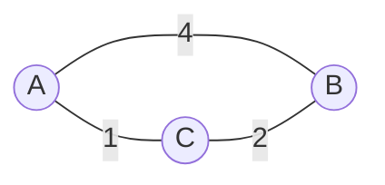

# Graphs & algorithms

Contents: static graphs · algorithm frames · trees · layout rules

## Static graph (Mermaid)

Undirected `---`, directed `-->`. Weights on edges as labels. Colour with `classDef visited fill:#2a7,color:#fff` + `class A,B visited`.

## Algorithm trace (frame strip)
One Mermaid or SVG per step, same node positions each frame (fixed layout is what makes the trace readable). Highlight: current node (red), finished (green), frontier (outline). Under each frame, a one-line state table: dist[ ] and queue/stack.
Dijkstra: edge weights ≥ 0 only; the invariant is "once a node is finalised, its distance is final". BFS: queue, frames list layers. DFS: stack, show discovery/finish times.
Invariants: dist values must come from actually running the algorithm (compute with 10 lines of Python or by hand step-by-step), not guessed; every frame follows from the previous by one operation.

## Trees, flows, planarity
Trees: `graph TD`. Flow: label edges `flow/capacity`; max-flow = min-cut: draw the cut as a dashed line, and check its capacity equals flow value. Planar drawings need straight edges that do not cross; if they cross, say it is non-planar or reroute (K5, K3,3 are not planar).

## Generators (preferred over hand-drawing)
Graph syntax: `A-B:4` undirected with weight, `A>B:3` directed / capacity. Layout: circular with node order chosen to minimise crossings (n ≤ 8); max-flow uses layers from the source. Frame strips draw the graph once and reuse it (`<use>`), so a strip costs about 3-7 KB.
- `bfs`: distances checked against Floyd–Warshall hop counts. `dfs`: discovery/finish times; the parenthesis theorem is checked for every pair; edges classified tree/back (forward/cross for directed).
- `kruskal` / `prim`: both run; weights must agree and (for up to C(m, n−1) ≤ 30000 subsets) equal the brute-force minimum over all spanning trees. Disconnected or directed input is refused.
- `maxflow`: Edmonds–Karp, capacity and conservation checked, and max flow must equal the capacity of the min cut read off the residual graph (so optimality is certified, not assumed).
- Not done yet: planarity/Kuratowski drawings (needs a planarity test); say so rather than sketch a "planar" drawing by hand.
