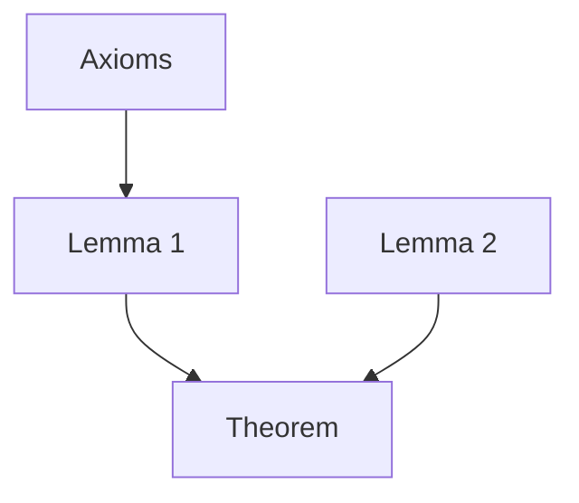

# Proofs & diagrams

Contents: proof dependency · commutative diagrams · case splits · induction

## Proof dependency graph (Mermaid)

Statements in nodes (short), arrows = "used in". Mark the key idea node. Invariants: no cycles (circular reasoning!); every leaf is an axiom or cited result.

## Commutative diagram (SVG, or Mermaid for simple cases)
Mermaid: `graph LR; A -->|f| B; B -->|g| C; A -->|h| C` (horizontal rows only; arrows labelled).
SVG grid: objects on a lattice, `<line marker-end>` arrows, label near midpoint offset perpendicular. Draw a small curved arrow ⟳ inside a face to say "commutes". Dashed arrow = induced/unique morphism (∃!). Invariants: each square's two paths have equal domain and codomain; composites type-check (cod f = dom g).

## Case split / iff
Tree with cases as branches and each leaf concluding the same statement; for "⇔" two blocks "⇒" and "⇐" side by side.

## Induction
Base case node -> step node, with the domino row of P(0),P(1),P(2),… and one arrow labelled "P(n)⇒P(n+1)". State which hypothesis (weak/strong) is used.

## Inequalities / epsilon-delta
Draw the graph, the ε-band around L (horizontal strip), and the δ-window around a (vertical strip); show the graph inside the box. Compute δ from ε for the specific f; check the box.

## Generators (preferred over hand-drawing)
- `proofdag`: layers = longest dependency chain from the axioms; if the dependency graph has a cycle the command fails with `circular reasoning: a → b → c → a`. Use it to check that a proof outline is not circular before drawing it.
- `comm`: grid spec `"A B;C D"`, arrows `A>B:f` (trailing `!` = dashed unique/induced arrow). Each path claim `"f h = g k"` (diagram order) is checked: consecutive arrows composable (cod f = dom g) and equal endpoints on both sides; only then is ⟳ drawn. This checks the *shape* of the claim, not the actual maps.
- `dfa`: refuses a transition function that is not total or not deterministic; shows the run (red), accept/reject, and the number of states of the minimal equivalent DFA (Moore refinement; unreachable states are dropped).
